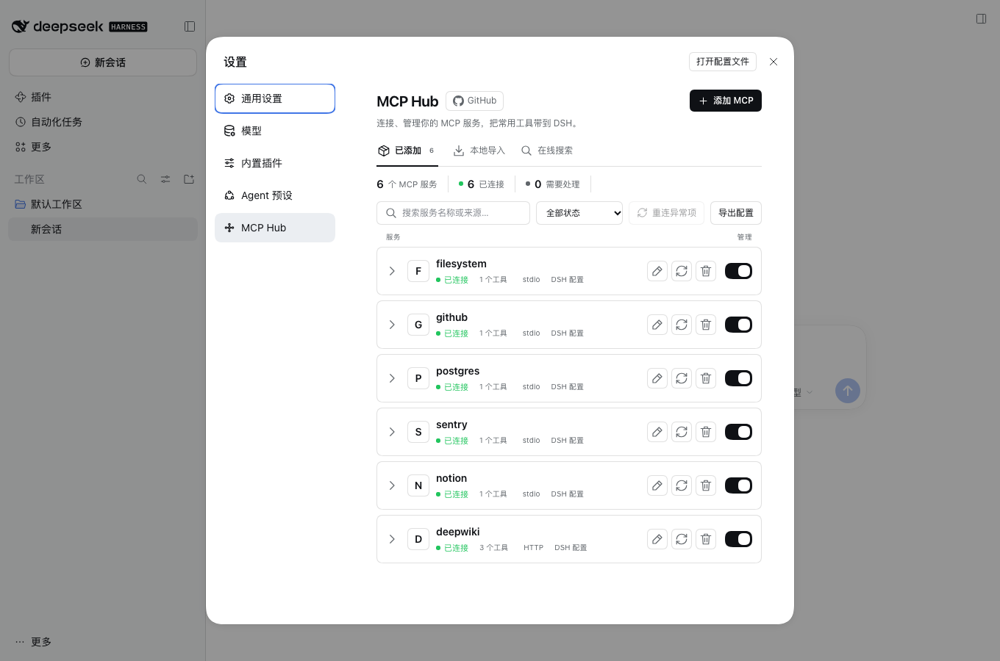

# DSH MCP Hub

<p>
  <a href="README.md"></a>
  &nbsp;
  <a href="README.en.md"></a>
</p>

> MCP servers from every AI client, in one DSH page: import, verify, troubleshoot — with secrets kept in the DSH credential service.

[](https://github.com/mr-hanlu/dsh-mcp-hub/actions/workflows/ci.yml) [](https://github.com/mr-hanlu/dsh-mcp-hub/releases) [](https://github.com/deepseek-ai/deepseek-harness) [](LICENSE)



DSH MCP Hub is a settings-page plugin for [DeepSeek Harness](https://github.com/deepseek-ai/deepseek-harness). It does not replace the official MCP Manager — it adds a better panel on top of it: real connection state, tool lists and failure reasons for every server, plus one-time import of servers already configured in Claude Code, Codex, Cursor, Windsurf and other clients.

Current version **0.2.x**, built for DSH **0.2.x** (0.2.2+).

## Why it exists

MCP configuration is scattered across a dozen JSON / TOML files. Changing one command means hunting through directories, secrets sit in plain text, and a server that will not connect leaves you reading logs. MCP Hub turns that into three steps:

1. **Import** — discover the configs of known clients on this machine, or paste JSON directly;
2. **Verify** — handshake and list tools through the official `probeServer`; nothing is saved until it passes;
3. **Manage** — secrets go to the DSH credential service and the config keeps only a reference; then start, stop, re-check and inspect from the page.

## Features

- **One place for every server**: add, edit, rename, enable, disable, restart, re-check and delete servers in the official Manager; reconnect failing rows in one click.
- **Local config import**: Claude Code / Claude Desktop, Codex, Gemini CLI, VS Code / Copilot, Copilot CLI, Windsurf, Cursor and OpenCode — TOML / JSON / JSONC, desktop, CLI and server variants.
- **Project-level discovery**: reads `.mcp.json`, `.cursor/mcp.json`, `.vscode/mcp.json` and friends from the launch directory, suffixing names on import so projects do not collide.
- **OAuth sign-in**: built-in discovery, dynamic client registration and PKCE for OAuth-protected remote servers; tokens go to the DSH credential service, then reconnect automatically and refresh before expiry.
- **Registry search**: query the official MCP Registry and pre-fill the editor with an npm / PyPI / OCI / remote HTTP server; **no auto-install, no silent writes**.
- **Test before save**: test rows one by one, then write them all at once; a failure writes nothing, and an existing name is skipped.
- **Background verification**: saving closes the dialog, then connection and tool registration finish in the background; a failure disables the server and keeps the reason instead of reporting success.
- **Secrets never land in config**: plaintext is written to the DSH credential service on save; the config keeps `${credential:MCPHUB_…}`. Reveal in place for 10 seconds, copy, or edit the key inline.
- **Shareable backups**: exports omit secrets by default and label files that include them; re-import recognises "same server, same connection, only the credential is missing".
- **Follows DSH**: Chinese and English, `--dsw-alias-*` theme variables, light/dark and narrow-window layouts, rendered as part of the settings page.
- **No hidden side effects**: scanning only reads configs and checks access — it never runs their commands, never modifies the source app, and never calls business tools to probe permissions.

## Install

### Requirements

- DSH **0.2.2 or later** in the 0.2.x line (`engines.dsh` is `>=0.2.2-0 <0.3.0-0`);
- `stdio` and `streamable-http` transports only; `sse` is not supported.

Installing does not require Node or npm. Those are only needed to build, test or run from source.

### Option A: plugin market (dshmarket, recommended)

Open **Plugins → Market**, search for **dsh-mcp-hub**, install, then open **Settings → MCP Hub**.

The listing has been submitted and is under review; if it does not show up yet, use Option B.

### Option B: Release archive (current recommendation)

1. Download [dsh-mcp-hub.tgz](https://github.com/mr-hanlu/dsh-mcp-hub/releases/latest/download/dsh-mcp-hub.tgz);
2. Desktop app: **Plugins → Add plugin** → select the `.tgz` file (or paste its absolute path);
3. CLI:

   ```sh
   dsh plugin --profile <profile> add "$HOME/Downloads/dsh-mcp-hub.tgz"
   ```

4. Restart when the desktop app asks (or restart the matching `dsh web`), then open **Settings → MCP Hub**.

The Release archive goes through the `files` whitelist and uses the host's own copy of the official packages — the shape users actually install.

### Option C: source link (development / debugging)

```sh
git clone https://github.com/mr-hanlu/dsh-mcp-hub.git
cd dsh-mcp-hub
npm ci
npm run build    # produces lib/client.js and lib/style.css, the files the plugin page loads
```

Desktop app: **Add plugin** → enter the repository's absolute path. CLI:

```sh
dsh plugin --profile hub-dev add "$PWD"
```

A local directory is a **link install**: after editing code, run `npm run build` again and restart DSH.

### Upgrade and uninstall

- **Market**: click **Update** on the plugin row; uninstall from the market card.
- **Release**: download the new `.tgz` and add it again — the same plugin is replaced, configuration and secrets are kept.
- **CLI**: `dsh plugin --profile <profile> remove dsh-mcp-hub`.

> **The npm package named `dsh-mcp-hub` belongs to someone else.** Do not install this project with `dsh plugin add dsh-mcp-hub`.
>
> **Do not install from GitHub source** (`github:mr-hanlu/dsh-mcp-hub`): the build output `lib/` is not committed, so a source install has no `lib/client.js` and the plugin page stays empty. Use Option A or B.

### Check that it works

- The list shows the servers already in the official Manager, without duplicating plugin-registered servers;
- Add a stdio server: test → save → the row turns "verified" and its tool count matches the details;
- For a remote server that needs a Bearer token, the config holds `${credential:MCPHUB_…}` rather than plaintext, and "Reveal" reads the value back.

## Compatibility

- `engines.dsh` in `package.json` (`>=0.2.2-0 <0.3.0-0`) is the only gate; DSH refuses to load the plugin and lists the unmet requirements.
- The official `@deepseek-ai/*` packages are `peerDependencies`; `devDependencies` are for local builds only. A **link install** prefers the repo's dev copies, while tarball and market installs use the host's copies — judge host compatibility with a Release install.
- If you really need to test outside that range, use the official version exemption (`dsh plugin allow-version`, re-authorise after an upgrade).

## Usage

Three tabs: **Added**, **Local import** and **Registry search**. Full details — scan paths, verification rules, secrets and exports, configuration keys — are in the [usage guide](docs/USAGE.md) (in Chinese).

## Security and boundaries

- Scanning only reads config files and checks access; it **never executes** their commands.
- Source app configs are not modified or continuously synced; import is a one-time copy.
- Servers registered by other plugins are read-only; inherited config can only be disabled; no data is migrated from other MCP managers.
- Remote servers support static env / headers, DSH credential references and OAuth sign-in; per-tool permissions remain out of scope.
- Per-tool permissions and Tool Search are out of scope for this version, and the UI keeps no placeholder entries.

## Documentation

| Document | Contents |
| --- | --- |
| [Usage guide](docs/USAGE.md) | Import, verification, secrets, registry search, configuration, known limits (Chinese) |
| [Testing guide](tests/README.md) | What each test layer covers, how to run it, required environment (Chinese) |
| [Development progress](docs/DEVELOPMENT_PROGRESS.md) | Finished work, verification records, known issues (Chinese) |
| [Next tasks](docs/NEXT_TASKS.md) | Prioritised follow-up work (Chinese) |
| [Desktop acceptance](docs/DESKTOP_ACCEPTANCE.md) | Manual checks for theme, narrow windows and official Manager boundaries (Chinese) |
| [Development plan](docs/DEVELOPMENT_PLAN_2026-11-17.md) | Auth layering and the OAuth plan (historical snapshot, Chinese) |
| [Documentation index](docs/README.md) | What every document is for and the reading order (Chinese) |

## Development

```sh
npm ci
npm run build
npm test          # unit tests
npm run check     # syntax and shared-layer checks
npm run dev       # local preview at http://127.0.0.1:4173 (dev aid only, not acceptance)
```

End-to-end tests create a temporary `DSH_HOME` and start a real Host or headless Chrome. See the [testing guide](tests/README.md) (Chinese) for how to run them, the environment variables and common failures.

## License

[MIT](LICENSE)