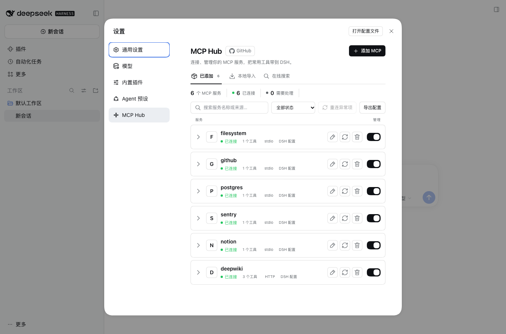

# DSH MCP Hub

<p>
  <a href="README.md"></a>
  &nbsp;
  <a href="README.en.md"></a>
</p>

> 把散落在各个 AI 客户端里的 MCP 配置，收进 DSH 的一个页面：扫描导入、逐项验证、启停排障，密钥统一交给 DSH 凭证服务保管。

[](https://github.com/mr-hanlu/dsh-mcp-hub/actions/workflows/ci.yml) [](https://github.com/mr-hanlu/dsh-mcp-hub/releases) [](https://github.com/deepseek-ai/deepseek-harness) [](LICENSE)



DSH MCP Hub 是 [DeepSeek Harness](https://github.com/deepseek-ai/deepseek-harness) 的设置页插件。它不替代官方 MCP Manager，而是在它之上提供一个更好用的管理面板：你能看到每个服务的真实连接状态、工具清单和失败原因，也能把 Claude Code、Codex、Cursor、Windsurf 等客户端里已经配好的服务一次性搬过来。

当前版本 **0.2.x**，面向 DSH **0.2.x**（0.2.2 起）。

## 为什么需要它

MCP 配置通常藏在十几个 JSON / TOML 文件里，改一个命令要翻目录，密钥以明文散落，服务连不上时只能看日志猜。MCP Hub 把这件事收敛成三步：

1. **导入**——自动发现本机已知客户端的配置，或直接粘贴 JSON；
2. **验证**——用官方 `probeServer` 真正握手、拉工具列表，通过才允许保存；
3. **托管**——密钥写入 DSH 凭证服务，配置里只留引用；之后在页面里启停、复诊、看诊断。

## 功能

- **统一管理**：添加、编辑、改名、启停、重启、复诊、删除官方 Manager 中的服务；异常项一键重连。
- **本机配置导入**：扫描 Claude Code / Claude Desktop、Codex、Gemini CLI、VS Code / Copilot、Copilot CLI、Windsurf、Cursor、OpenCode，兼容 TOML / JSON / JSONC 与桌面端、CLI、Server 变体。
- **项目级发现**：读取启动目录下的 `.mcp.json`、`.cursor/mcp.json`、`.vscode/mcp.json` 等，导入时自动加名称后缀，避免跨项目重名。
- **OAuth 登录**：为支持 OAuth 的远程服务内置发现、动态客户端注册与 PKCE 授权；令牌写入 DSH 凭证服务，授权后自动重连，并在过期前刷新。
- **在线搜索**：查询官方 MCP Registry，选 npm / PyPI / OCI / 远程 HTTP 后预填编辑页；**不自动安装、不静默写入**。
- **先测试再保存**：逐行测试、批量一次性写入；失败零写入，已存在同名服务自动跳过。
- **后台验证**：保存即关闭窗口，连接与工具注册在后台完成；失败自动停用并保留原因，不把失败显示成成功。
- **密钥不出现在配置里**：明文在保存时写入 DSH 凭证服务，配置只保留 `${credential:MCPHUB_…}`；支持就地显示 10 秒、复制、行内改密钥。
- **可分享的备份**：导出默认不含密钥，含密钥时文件名明确标注；重新导入能识别“同名同连接、只是缺凭据”的情况。
- **跟随 DSH**：中英双语、`--dsw-alias-*` 主题变量、深浅色与窄窗口适配，作为设置页的一部分存在。
- **无隐藏副作用**：扫描只读配置、不执行启动命令；不修改来源应用的文件；不调用业务工具来探测权限。

## 安装

### 系统要求

- DSH **0.2.2 及以上**（只覆盖 0.2.x；`engines.dsh` 为 `>=0.2.2-0 <0.3.0-0`）；
- 只支持 `stdio` 与 `streamable-http`，`sse` 明确不支持。

安装不需要 Node 或 npm；只有从源码运行、构建和测试时才需要。

### 方式 A：插件市场（dshmarket，推荐）

在 DSH 的 **插件页 → 市场** 搜索 **dsh-mcp-hub**，安装后打开 **设置 → MCP Hub**。

条目已于 2026-11-19 收录。如果本机市场缓存里还没有，重启 DSH 后再搜，或改用方式 B。

### 方式 B：Release 安装（手动 / 离线）

1. 下载 [dsh-mcp-hub.tgz](https://github.com/mr-hanlu/dsh-mcp-hub/releases/latest/download/dsh-mcp-hub.tgz)；
2. 桌面应用：**插件 → 添加插件** → 选择这个 `.tgz` 文件（或填入它的绝对路径）；
3. CLI：

   ```sh
   dsh plugin --profile <profile> add "$HOME/Downloads/dsh-mcp-hub.tgz"
   ```

4. 按桌面提示重启，或重启对应的 `dsh web`；打开 **设置 → MCP Hub**。

Release 包走 `files` 白名单，使用宿主自带的官方依赖，是“用户实际装到的包”的真实形态。

### 方式 C：源码 link（开发 / 调试）

```sh
git clone https://github.com/mr-hanlu/dsh-mcp-hub.git
cd dsh-mcp-hub
npm ci
npm run build    # 生成 lib/client.js 与 lib/style.css，插件页加载的就是这两个文件
```

桌面应用：**添加插件** → 输入仓库的绝对路径。CLI：

```sh
dsh plugin --profile hub-dev add "$PWD"
```

本地目录是 **link 安装**：改代码后需要重新 `npm run build` 并重启 DSH 才会生效。

### 升级与卸载

- **市场**：插件行上出现 Update 时点一下即可；卸载也在市场卡片里。
- **Release**：下载新版本 `.tgz` 重新添加，同一插件会被替换，配置与密钥保留。
- **CLI**：`dsh plugin --profile <profile> remove dsh-mcp-hub`。

> **npm 上的 `dsh-mcp-hub` 是他人占位包，不是本项目。** 不要用 `dsh plugin add dsh-mcp-hub` 按包名安装。
>
> **GitHub 源码安装是 DSH 官方支持的安装方式，本仓库也可以。** 插件页的「添加插件」接受 npm 包、本地路径、Git 地址和 tarball；Git 地址会按 pnpm 的 git 依赖安装，DSH 安装前还会用 `git ls-remote` 检查仓库。本仓库已把 `lib/` 构建产物一起提交，所以 `github:mr-hanlu/dsh-mcp-hub` 能加载完整的设置页。源码安装不会自动更新，升级仍建议用市场或 tarball；如果你是改源码的人，先 `npm run build`，再把 `lib/` 一起提交，否则安装后的页面会缺前端。

### 装好后确认

- 列表显示官方 Manager 已有服务，且不重复列出插件注册的服务；
- 加一个 stdio 服务：测试连接 → 保存 → 行状态变为「验证通过」，工具数与详情一致；
- 需要 Bearer token 的远程服务：配置里是 `${credential:MCPHUB_…}` 而不是明文，点「显示」能读回值。

## 兼容性

- `package.json` 的 `engines.dsh`（`>=0.2.2-0 <0.3.0-0`）是唯一判据，不满足时 DSH 拒绝加载并列出未满足项。
- 官方 `@deepseek-ai/*` 包声明为 `peerDependencies`，`devDependencies` 只供本地构建；**link 安装**会优先用仓库的 dev 副本，只有 tarball / 市场安装才真正使用宿主副本。判断宿主兼容性请以 Release 安装为准。
- 确需跨版本范围验证时，使用官方版本豁免（`dsh plugin allow-version`，升级后需重新授权）。

## 使用

三个页签：**已添加**、**本地导入**、**在线搜索**。完整说明（扫描范围、验证口径、密钥与导出规则、配置项）见 [使用说明](docs/USAGE.md)。

## 安全与边界

- 扫描只读取配置文件和检查访问权限，**不执行**里面的启动命令；
- 不修改、不持续同步来源应用配置；导入是一次性复制；
- 插件注册的服务只读，继承配置只能停用；不迁移其他 MCP 管理插件的数据；
- 远程服务支持静态 env / headers、DSH 凭证引用与 OAuth 登录；单工具权限仍不在范围内。
- 单工具权限管理与 Tool Search 不在本版本范围，界面不保留占位入口。

## 文档

| 文档 | 内容 |
| --- | --- |
| [使用说明](docs/USAGE.md) | 导入、验证、密钥、在线搜索、配置项与已知边界 |
| [测试说明](tests/README.md) | 每层测试做什么、怎么跑、需要什么环境 |
| [开发进度](docs/DEVELOPMENT_PROGRESS.md) | 已完成能力、验证记录与已知问题 |
| [后续任务](docs/NEXT_TASKS.md) | 按优先级排列的下一步工作 |
| [桌面验收清单](docs/DESKTOP_ACCEPTANCE.md) | 只能人工确认的主题、窄窗与官方 Manager 边界 |
| [开发计划](docs/DEVELOPMENT_PLAN_2026-11-17.md) | 认证分层与 OAuth 方案（历史快照） |
| [文档索引](docs/README.md) | 全部文档的用途与阅读顺序 |

## 开发

```sh
npm ci
npm run build
npm test          # 单测
npm run check     # 语法与共享层检查
npm run dev       # 本地预览 http://127.0.0.1:4173（仅开发辅助，不能替代真实验收）
```

端到端测试建临时 `DSH_HOME`、启动真实 Host 或无头 Chrome；怎么跑、环境变量和常见失败见 [测试说明](tests/README.md)。

## License

[MIT](LICENSE)